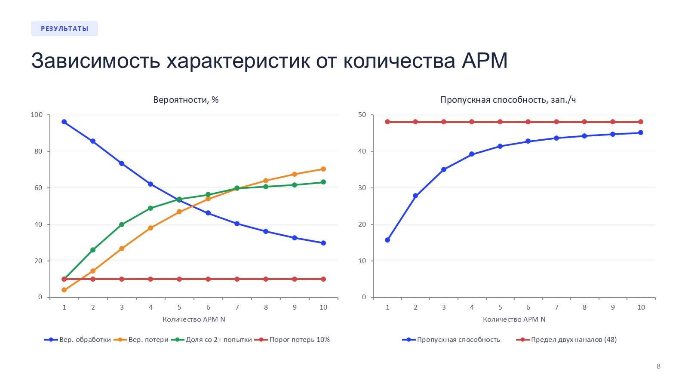
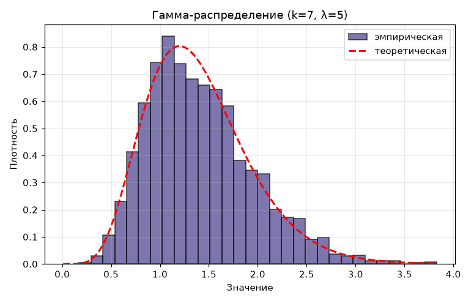
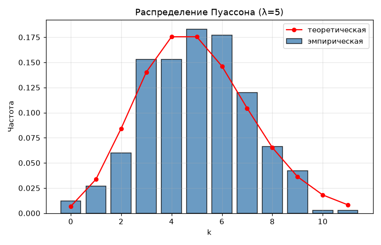

# Моделирование систем: генераторы случайных величин и GPSS

Работы по курсу «Моделирование систем»: генерация случайных чисел на Python, имитационные модели систем массового обслуживания в GPSS World и курсовая про сервер с двумя каналами связи и повторными вызовами.

## Курсовая: сервер с двумя каналами и повторными вызовами

[course-project-retrial-queue](course-project-retrial-queue)

N рабочих мест отправляют запросы на сервер по двум каналам связи. Если оба канала заняты, запрос с вероятностью 0.25 теряется, иначе повторяется через случайное время. Нужно было найти вероятность обработки, пропускную способность, загрузку каналов и оптимальное число рабочих мест за 3 часа работы.

Модель написана в GPSS World ([model.gps](course-project-retrial-queue/model.gps)), для каждого N от 1 до 10 сделано по 200 прогонов, по результатам построена регрессия. Получилось, что система быстро насыщается: при двух рабочих местах теряется уже 14.5% запросов, а пропускная способность упирается примерно в 45 запросов в час.



Презентация: [PDF](course-project-retrial-queue/presentation.pdf), [PowerPoint](course-project-retrial-queue/presentation.pptx)

## Лабораторные

**[lab1-lcg-uniform](lab1-lcg-uniform)** (Python). Генератор равномерных случайных чисел на [0, 1] методом вычетов, проверка периода и согласия с равномерным законом по хи-квадрат, гистограмма и функция распределения. Сгенерированные числа сохраняются в `numbers.txt`.

**[lab2-random-distributions](lab2-random-distributions)** (Python). На основе того же генератора получены равномерное, гамма, нормальное, отражённое нормальное, дискретное распределение и распределение Пуассона. Для каждого есть гистограмма с теоретической кривой.

| Гамма-распределение | Пуассон |
|---|---|
|  |  |

**[lab3-gpss-basics](lab3-gpss-basics)** (GPSS). Базовые задачи: поток транзактов, ограничение по числу транзактов и по времени, одноканальное устройство, два кассира с предпочтением, морской порт с причалами.

**[lab4-gpss-models](lab4-gpss-models)** (GPSS). Одноканальная система с двумя типами заявок и приоритетом, комплекс коммутации сообщений с двумя каналами передачи данных.

## Запуск

Python-лабы:

```
pip install numpy scipy matplotlib
cd lab2-random-distributions
python random_distributions.py
```

Файлы `.gps` открываются в GPSS World (есть бесплатная студенческая версия).

---

Учебная работа, РГУ нефти и газа им. Губкина
